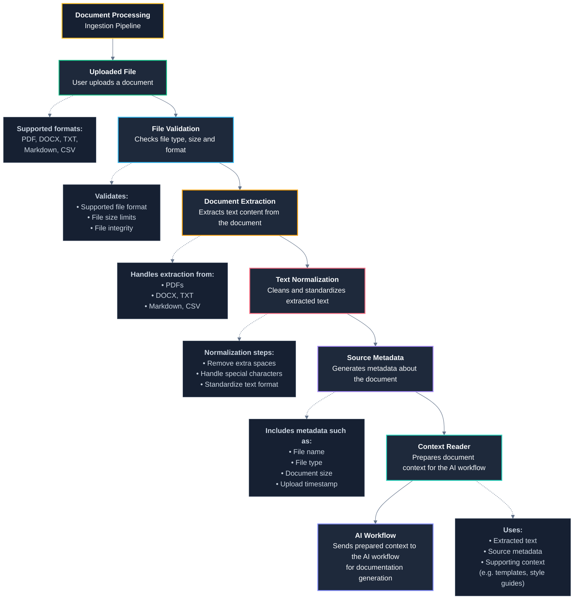

# GitLab AI Content & Documentation Engine

> **AI-assisted, source-grounded documentation generation with human review and controlled publishing.**<br>
🚀 [View Live Application](https://gitlab-ai-docs-engine.vercel.app/login)


A full-stack AI documentation platform that transforms release notes, technical documents, API specifications, engineering updates, and uploaded files into structured, review-ready documentation.

The platform combines document ingestion, source/context normalization, a multi-stage AI workflow, human review, role-based access control, version history, quality checks, and controlled publishing.

---

##  Live Demo link 
https://gitlab-ai-docs-engine.vercel.app/login

### Frontend Application

https://gitlab-ai-docs-engine.vercel.app/login

###  Backend API

https://content-engine-backend-7hal.onrender.com/

###  FastAPI Swagger Documentation

https://content-engine-backend-7hal.onrender.com/docs

### OpenAPI Specification

https://content-engine-backend-7hal.onrender.com/openapi.json

**Deployment**

- Frontend: Vercel
- Backend: Render
- API: FastAPI
- Authentication: Firebase Authentication
- Database: SQLite locally / PostgreSQL or Supabase in deployed environments

---

#  Overview

The GitLab AI Content & Documentation Engine is designed to automate technical documentation generation while keeping humans in control of the final output.

Instead of directly sending raw project information to an AI model, the system processes uploaded source material, extracts relevant context, generates documentation through specialized stages, performs technical review, optimizes the tone, and finally sends the result through a human approval workflow.

### High Level Flow


---

# Key Features

## AI-Assisted Documentation

The system uses a multi-stage AI workflow instead of relying on a single prompt.

The workflow consists of:

1. **Context Reader**
2. **Documentation Writer**
3. **Technical Reviewer**
4. **Tone Optimizer**
5. **Publishing Coordinator**

Each stage has a specific responsibility in the documentation pipeline.

---

##  Source-Grounded Generation

The system processes source documents before generating content.

Supported input formats include:

- PDF
- DOCX
- TXT
- Markdown
- CSV

The system preserves source references during document processing so generated content can be reviewed against the original material.

For PDFs, page-level source information can be preserved.

Scanned/image-only PDFs require OCR and are rejected when usable text cannot be extracted.

---

##  Context Reader

The Context Reader converts raw source material into structured evidence.

It identifies:

- Facts
- Changes
- Requirements
- Entities
- Gaps
- Contradictions
- Source references

This structured context is then passed to the downstream AI stages.

---

## Documentation Writer

The Documentation Writer creates customer-facing or engineering-facing documentation from the normalized source context.

The writer is designed to work from extracted evidence rather than blindly generating information.

---

## Technical Reviewer

The Technical Reviewer checks the generated documentation for issues such as:

- Unsupported claims
- Missing information
- Technical risks
- Contradictions
- Source coverage problems
- Potentially incorrect statements

Review findings are preserved as part of the draft/review process.

---

##  Tone Optimizer

The Tone Optimizer improves readability and consistency while keeping the technical meaning of the documentation intact.

It can be used to produce documentation suitable for different audiences and communication styles.

---

##  Publishing Coordinator

The Publishing Coordinator prepares the final documentation for controlled output.

Publishing is protected by the human approval process rather than allowing the AI workflow to publish content automatically.

---

#  Authentication & Role-Based Access Control

The application uses Firebase Authentication with backend verification.

Authentication flow:

```text
User Login
    ↓
Firebase Authentication
    ↓
Firebase ID Token
    ↓
Frontend
    ↓
FastAPI Backend
    ↓
Firebase Token Verification
    ↓
User / Role Lookup
    ↓
Authorized API Access
```

Supported roles include:

| Role | Refine | Request Revision | Approve | Publish |
|---|---:|---:|---:|---:|
| Writer | ✅ | ❌ | ❌ | ❌ |
| Reviewer | ✅ | ✅ | ❌ | ❌ |
| Approver | ✅ | ✅ | ✅ | ❌ |
| Admin | ✅ | ✅ | ✅ | ✅ |

New Firebase users receive the default `writer` role. Elevated roles are managed by administrators.


#  Document Processing


---

#  Supported Documents

| Format | Supported |
|---|---|
| PDF | ✅ |
| DOCX | ✅ |
| TXT | ✅ |
| Markdown | ✅ |
| CSV | ✅ |

PDF source markers can preserve the original filename and page number.

---

#  System Architecture

```text
┌───────────────────────────────┐
│       React Frontend          │
│                               │
│ Dashboard                     │
│ Content Intake                │
│ Jobs                          │
│ Draft Review                  │
│ Metrics                       │
└───────────────┬───────────────┘
                │
                ▼
┌───────────────────────────────┐
│        FastAPI Backend        │
│                               │
│ Authentication               │
│ RBAC                         │
│ Content Jobs                 │
│ Drafts                       │
│ Reviews                      │
│ Refinement                   │
│ Publishing                   │
│ Metrics                      │
└───────────────┬───────────────┘
                │
       ┌────────┴────────┐
       ▼                 ▼
┌─────────────┐   ┌─────────────────┐
│  Database   │   │ Document        │
│             │   │ Processing      │
│ SQLite      │   │ PDF             │
│ PostgreSQL  │   │ DOCX            │
│ Supabase    │   │ TXT             │
└─────────────┘   │ MD / CSV        │
                  └────────┬────────┘
                           │
                           ▼
                 ┌──────────────────┐
                 │    AI Workflow   │
                 │                  │
                 │ Context Reader   │
                 │ Writer           │
                 │ Reviewer         │
                 │ Tone Optimizer   │
                 │ Publisher        │
                 └──────────────────┘
```

---

#  AI Workflow




---

#  Mock AI Mode

The project supports a mock AI mode for local development and demonstrations.

This allows the application to run without an external AI API key.

```env
AI_PROVIDER=mock
```

In mock mode:

- Document extraction still runs locally.
- AI model calls are replaced with deterministic fallback output.
- Frontend and backend flows can be tested without consuming AI API quota.

---

#  Real AI Configuration

For real AI generation, configure the AI provider through environment variables.

Example:

```env
AI_PROVIDER=openai_compatible
OPENAI_API_KEY=your_api_key
OPENAI_BASE_URL=https://api.openai.com/v1
OPENAI_MODEL=gpt-4.1-mini
AI_TIMEOUT_SECONDS=120
```

> Never commit real API keys to GitHub.

For Gemini or another OpenAI-compatible provider, configure the corresponding provider endpoint and model according to the provider's API requirements.

---

#  Database

The project supports SQLite for local development.

Default:

```env
DATABASE_URL=sqlite:///./data/app.db
```

For production or hosted deployments, PostgreSQL-compatible databases such as Supabase can be configured using:

```env
DATABASE_URL=your_postgresql_connection_string
```

The database stores application data such as:

- Users
- Roles
- Content jobs
- Drafts
- Draft versions
- Review decisions
- Audit information
- Metrics

---

#  API

The FastAPI backend exposes the following major endpoints.

| Method | Endpoint | Purpose |
|---|---|---|
| GET | `/api/auth/me` | Get current authenticated user |
| POST | `/api/content-jobs` | Create content job |
| GET | `/api/content-jobs` | List content jobs |
| GET | `/api/content-jobs/{job_id}` | Get job details |
| POST | `/api/content-jobs/{job_id}/run` | Run AI workflow |
| POST | `/api/drafts/{draft_id}/review` | Review draft |
| POST | `/api/drafts/{draft_id}/refine` | Refine draft |
| POST | `/api/publish/export` | Export approved content |
| GET | `/api/metrics` | Get operational metrics |
| GET | `/health` | Health check |
| GET | `/health/ready` | Readiness check |

Interactive API documentation:

**Swagger UI**

https://content-engine-backend-7hal.onrender.com/docs

**OpenAPI**

https://generativelanguage.googleapis.com/v1beta/openai/ 

---

#  Metrics

The application provides operational metrics through the backend API.

Metrics can be used to understand:

- Content job activity
- Draft processing
- Review activity
- Workflow operations
- System usage

Frontend metrics are available through the dashboard.

---

#  Draft & Version History

Generated documentation is treated as a draft before final publication.

The system supports:

- Draft creation
- Review decisions
- Revision requests
- Refinement
- New draft versions
- Approval
- Export

This prevents an AI-generated document from automatically becoming the final published document.

---

#  Human Review

Human review is a core part of the workflow.

```text
AI Generated Draft
        ↓
   Human Reviewer
        ↓
 ┌──────┴────────┐
 │               │
Approve      Request Revision
 │               │
 ↓               ↓
Export          Refine
                 ↓
            New Version
```

This provides an additional quality-control layer between AI generation and publication.

---

#  Project Structure

```text
gitlab-ai-content-engine/
│
├── backend/
│   ├── ai/
│   │   ├── agents/
│   │   ├── prompts/
│   │   ├── retrieval/
│   │   └── evaluation/
│   │
│   ├── app/
│   │   ├── api/
│   │   ├── auth/
│   │   ├── db/
│   │   ├── models/
│   │   └── services/
│   │
│   ├── requirements.txt
│   └── ...
│
├── frontend/
│   ├── app/
│   ├── components/
│   └── ...
│
├── data/
│   └── sample_inputs/
│
├── deployment/
│
├── docs/
│   ├── architecture.md
│   ├── workflow_states.md
│   └── demo_script.md
│
├── .env.example
├── docker-compose.yml
├── package.json
└── README.md
```

---

#  Technology Stack

## Frontend

- React
- JavaScript
- Dashboard UI
- Firebase Authentication
- Vercel

## Backend

- Python
- FastAPI
- Pydantic
- SQLAlchemy
- Uvicorn

## Authentication

- Firebase Authentication
- Firebase Admin verification
- Backend-managed roles

## Database

- SQLite
- PostgreSQL
- Supabase-compatible PostgreSQL

## AI

- Crew AI
- Pydantic
- Chroma DB 
- Gemini as primary LLM
- Mock AI mode
- OpenAI-compatible provider configuration

## Deployment

- Vercel
- Render
- Docker
- Docker Compose

---

# Local Setup

## 1. Clone the repository

```bash
git clone https://github.com/DhamodharThyiagarajan/gitlab-ai-content-engine.git
cd gitlab-ai-content-engine
```

---

# 2. Backend Setup

Open a terminal:

```bash
cd backend
```

Create a virtual environment:

### Windows

```powershell
python -m venv .venv
.\.venv\Scripts\activate
```

### macOS / Linux

```bash
python3 -m venv .venv
source .venv/bin/activate
```

Install dependencies:

```bash
pip install -r requirements.txt
```

---

# 3. Environment Configuration

Copy the example environment file.

### Windows

```powershell
Copy-Item ..\.env.example .env
```

### macOS / Linux

```bash
cp ../.env.example .env
```

Configure the required variables.

Example:

```env
DATABASE_URL=sqlite:///./data/app.db

AI_PROVIDER=mock

AI_TIMEOUT_SECONDS=120
```

For real AI:

```env
AI_PROVIDER=openai_compatible
OPENAI_API_KEY=your_api_key
OPENAI_BASE_URL=https://api.openai.com/v1
OPENAI_MODEL=gpt-4.1-mini
AI_TIMEOUT_SECONDS=120
```

Configure Firebase Admin credentials and project settings according to your Firebase project.

---

# 4. Start the Backend

From the `backend` directory:

```bash
uvicorn app.main:app --reload --port 8000
```

Backend:

```text
http://localhost:8000
```

Swagger:

```text
http://localhost:8000/docs
```

OpenAPI:

```text
http://localhost:8000/openapi.json
```

Health:

```text
http://localhost:8000/health
```

---

# 5. Frontend Setup

Open another terminal:

```bash
cd frontend
```

Install dependencies:

```bash
npm install
```

Configure the frontend environment.

Example:

```env
NEXT_PUBLIC_BACKEND_URL=http://localhost:8000
```

Configure the Firebase web application variables for the same Firebase project used by the backend.

Start the frontend:

```bash
npm run dev
```

Open:

```text
http://localhost:3000
```

---

#  Docker Setup

The repository also contains Docker Compose configuration.

From the repository root:

```bash
docker compose up --build
```

The application will start using the configured environment variables.

---

#  Firebase Configuration

The frontend and backend must use the same Firebase project.

### Backend

Configure:

```env
FIREBASE_PROJECT_ID=your_project_id
```

and the required Firebase Admin credentials.

### Frontend

Configure the Firebase web application settings:

```env
NEXT_PUBLIC_FIREBASE_API_KEY=...
NEXT_PUBLIC_FIREBASE_AUTH_DOMAIN=...
NEXT_PUBLIC_FIREBASE_PROJECT_ID=...
NEXT_PUBLIC_FIREBASE_STORAGE_BUCKET=...
NEXT_PUBLIC_FIREBASE_MESSAGING_SENDER_ID=...
NEXT_PUBLIC_FIREBASE_APP_ID=...
```

Do not commit private credentials or service-account files.

---

#  Deployment

## Frontend

The frontend is deployed using Vercel.

Production URL:

```text
https://gitlab-ai-content-engine-nu.vercel.app/login
```

The frontend should be configured to use the deployed backend:

```env
NEXT_PUBLIC_BACKEND_URL=https://gitlab-ai-content-engine-api.onrender.com
```

---

## Backend

The FastAPI backend is deployed using Render.

Production API:

```text
https://gitlab-ai-content-engine-api.onrender.com
```

Swagger:

```text
https://gitlab-ai-content-engine-api.onrender.com/docs
```

The backend must be configured with the appropriate production environment variables, Firebase credentials, database connection, and AI provider configuration.

---

#  Production Architecture

```text
                    Internet
                       │
                       ▼
        ┌─────────────────────────┐
        │        Vercel           │
        │     React Frontend      │
        └────────────┬────────────┘
                     │
                     │ HTTPS API
                     ▼
        ┌─────────────────────────┐
        │         Render          │
        │      FastAPI Backend    │
        └───────┬─────────┬───────┘
                │         │
                │         ├──────────────┐
                │         │              │
                ▼         ▼              ▼
           Firebase    Database      AI Provider
           Auth        PostgreSQL     / Gemini /
                       / Supabase     OpenAI-compatible
```

---

#  Security Considerations

The project follows several security principles:

- Firebase ID token verification on the backend
- Role-based authorization
- Backend-controlled publishing
- Human approval before export
- Environment-based secret configuration
- No API keys committed to source control
- Source references for generated documentation
- Draft/version history
- Audit-oriented workflow

---

#  Testing & Demo

For a local demo without an AI API key:

```env
AI_PROVIDER=mock
```

Then start:

```bash
uvicorn app.main:app --reload --port 8000
```

and:

```bash
npm run dev
```

A typical demonstration flow is:

```text
Login
  ↓
Create Content Job
  ↓
Upload Source Document
  ↓
Process Document
  ↓
Run AI Workflow
  ↓
Generate Draft
  ↓
Review Draft
  ↓
Approve / Request Revision
  ↓
Refine if Required
  ↓
Export Approved Documentation
```

---

#  Documentation

Additional project documentation is available in:

```text
docs/
```

Important files include:

```text
docs/architecture.md
docs/workflow_states.md
docs/demo_script.md
```

---

#  Project Goals

The project is designed to demonstrate how an AI-assisted documentation platform can combine:

- Generative AI
- Document processing
- Source grounding
- Structured AI workflows
- Human-in-the-loop review
- Authentication
- Role-based access control
- Database persistence
- Draft versioning
- Quality checks
- Controlled publishing
- Full-stack web development
- Cloud deployment

---

#  Future Enhancements

Potential future improvements include:

- Advanced vector database retrieval
- Richer knowledge-base integration
- Additional AI providers
- Automated GitLab repository integration
- GitLab webhook integration
- More document formats
- Advanced evaluation pipelines
- More granular permissions
- Improved observability
- Automated CI/CD workflows
- Additional export formats
- Advanced analytics

---

#  Development

The project separates responsibilities between the frontend, backend, document processing, AI workflow, and deployment configuration.

This makes it possible to independently improve:

```text
Frontend
Backend APIs
Authentication
Database
Document Processing
AI Workflow
Review System
Publishing
Deployment
```

---

#  Important Notes

- Do not commit `.env` files containing real credentials.
- Do not expose Firebase Admin private keys.
- Do not expose AI API keys.
- Production authentication requires correctly configured Firebase credentials.
- Real AI generation requires a valid AI provider configuration.
- Mock AI mode can be used for local demonstrations without an external model API.

---

#  License

This project is intended for development, demonstration, and educational purposes unless a separate license is provided.

---

---
# Screenshots
---
## 1. Home 


## 2. Application Dashboard


## 3.Create content page


 ## 4. Review page


## 5. Job Page


## 6. Analytics Page


## 7. Role Management Page


#  Project Summary

**GitLab AI Content & Documentation Engine** is a full-stack AI-powered documentation platform that takes source material, extracts structured context, generates documentation through specialized AI stages, performs technical review, and places the result into a human-controlled approval and publishing workflow.

```text
Source Documents
       ↓
Document Processing
       ↓
Context Extraction
       ↓
AI Documentation Workflow
       ↓
Technical Review
       ↓
Tone Optimization
       ↓
Human Review
       ↓
Approval
       ↓
Export / Publish
```

**Frontend:** Vercel  
**Backend:** FastAPI + Render  
**Authentication:** Firebase  
**Database:** SQLite / PostgreSQL / Supabase  
**AI:** Configurable provider  
**Workflow:** Source-grounded multi-stage generation + human review

## Contributors 

This project was developed collaboratively by:

| Contributor | Role / Contribution |


| ANKUSH | FRONTEND |


| TINA   | BACKEND AND API , AI AGENTS AND RETRIEVAL|


| ADITYA |  AI AGENTS |


| PRUTHVI | ARCHITECTURE |


| NITANT | DEPLOYMENT  |


| VRUSHABH | QA AND TESTING|


All contributors participated collaboratively in the development, testing, documentation, and refinement of the project
And also performed Qulity Assurance And different type of testing to make sure that our AI workflow, APIs, document 
processing pipeline and overall (0:10) system are working correctly
